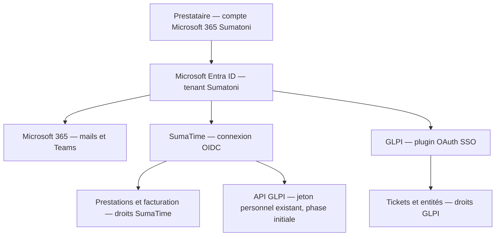

# Étude — connexion Microsoft Entra ID pour SumaTime et GLPI

Décision proposée le 7 octobre 2026. Étude uniquement : aucun changement des droits Entra, des comptes GLPI ou de l’authentification de production.

## Objectif prestataire

Le propriétaire confirme que les prestataires possèdent déjà un compte Microsoft 365 Sumatoni. Utiliser ce compte pour la messagerie, GLPI et SumaTime. Après connexion Microsoft dans le même navigateur, le passage entre outils réutilise la session Microsoft selon la politique du tenant ; une nouvelle demande MFA reste possible. Chaque application conserve ses propres données, autorisations et sessions.

Proposition : tenant Microsoft 365 Sumatoni uniquement, deux applications Entra distinctes pour GLPI et SumaTime, et des inscriptions distinctes pour les prévisualisations. Pas d’ouverture à tous les tenants Microsoft pour ce besoin.

## Architecture proposée

Le SSO authentifie la personne. L’autorisation de voir ARRG, Salarypay ou les prestations des autres reste définie dans chaque outil. Se connecter avec Microsoft ne donne pas automatiquement Super-Admin ni accès à toutes les entités.

## SumaTime : changements à réaliser

État vérifié dans le code : comptes locaux et LDAP, cookie de session serveur valable 12 heures, table accounts limitée aux fournisseurs local/ldap ; getMember dépend de cette table. Entra n’est donc pas activable par un simple réglage actuel.

Ajouter une connexion OpenID Connect par code d’autorisation avec PKCE, state et nonce, traitée côté serveur. Employer une bibliothèque maintenue et valider signature, émetteur, audience, tenant, expiration et nonce. Identifiants de l’application stockés sur le serveur ; préférer un certificat pour l’application SumaTime quand le client OIDC retenu le permet. Aucun accès à la messagerie n’est nécessaire : permissions initiales openid/profile/email, sans Mail.Read.

L’identité durable doit être le couple tenant ID + object ID (tid, oid). Le nom et l’e-mail servent à l’affichage ; ils ne suffisent pas à fusionner automatiquement deux comptes. Associer explicitement le compte Microsoft au member_id existant pour conserver historique, forfaits, tarifs, jeton GLPI et exports.

Prévoir une table d’identités externes liée aux membres, et adapter accounts, sessions, getMember, types et Mon compte pour accepter un fournisseur Entra sans demander de mot de passe local. Définir si un membre conserve une connexion locale/LDAP pendant la transition ; ne pas empiler des comptes identiques. Garder un administrateur local de secours.

Rôles proposés : Prestataire et Administrateur. Accès réservé aux utilisateurs assignés et rôle Administrateur accordé explicitement. Aucun administrateur créé par simple correspondance de domaine e-mail. Les comptes désactivés dans SumaTime restent refusés, même après une connexion Microsoft valide.

La suppression d’un accès Entra bloque les nouvelles connexions ; elle ne garantit pas l’expiration immédiate du cookie applicatif existant. Cible : sessions courtes renouvelées via Entra, délai de révocation documenté, et suppression immédiate des sessions SumaTime pour un départ urgent. Le protocole de départ couvre également le compte et les jetons GLPI.

## GLPI : voie officielle et migration

La documentation officielle décrit le plugin OAuth SSO et le fournisseur Entra. L’édition actuelle documentée exige GLPI Network Basic ou supérieur en auto-hébergement et affiche une compatibilité GLPI 11/12. Vérifier la version réellement installée, la version du plugin compatible et l’abonnement avant installation ; ne pas déduire qu’une ancienne instance est compatible avec le dernier plugin.

Créer une application Entra dédiée, limiter le tenant à Sumatoni et recopier l’URL de retour générée par le plugin. Suivre les claims et permissions de la version installée : la procédure officielle indique email, profile, offline_access et User.Read. Cela lit l’identité, pas les mails. Conserver le secret côté serveur et préparer son renouvellement si le plugin utilise un secret.

Inventorier les utilisateurs LDAP existants et leurs logins complets. Tester le rattachement au même identifiant GLPI sur un utilisateur pilote : mêmes tickets, groupes, autorisations et entités après connexion Microsoft. Ne pas recréer des utilisateurs ni retirer le domaine des logins globalement pour contourner une collision.

Les règles GLPI peuvent attribuer un profil à partir des rôles Entra, mais cette correspondance doit être définie explicitement. Prévoir les autorisations des prestataires sur les entités clients et le profil utilisé par l’API. Le diagnostic ARRG du 5 octobre a montré qu’un profil API Admin sans droit sur l’entité 1 bloque ses tickets, même si le même compte possède Super-Admin sous un autre profil.

## API GLPI : périmètre distinct

SumaTime utilise actuellement apirest.php et un jeton personnel GLPI chiffré par membre. La session OIDC Microsoft du navigateur n’est pas ce jeton. Phase initiale : conserver ces connexions personnelles et vérifier qu’elles restent rattachées aux utilisateurs GLPI existants après migration SSO.

Le résultat visible sera une connexion Microsoft aux deux interfaces, mais la connexion API GLPI pourra encore demander une configuration personnelle initiale. Ne pas promettre sa disparition. Une phase suivante pourra étudier les possibilités OAuth de l’API de la version GLPI réellement installée, sans compte technique partagé qui masquerait l’identité et les droits du prestataire.

## Réseau, HTTPS et licences

Les adresses actuelles sont internes : sumatime.home.sumatoni.be et glpi.home.sumatoni.be. Entra accepte des URL privées HTTPS selon la documentation du plugin. Le navigateur doit pouvoir atteindre ces URL (réseau interne/VPN) et joindre Microsoft ; les serveurs doivent pouvoir joindre les endpoints Microsoft requis. Le SSO ne fournit pas à lui seul un accès depuis Internet.

Remplacer les avertissements de certificats auto-signés par un certificat reconnu sur les appareils. Un certificat public obtenu par validation DNS est une option si l’accès au DNS est disponible ; aucune ouverture des applications à Internet n’est nécessaire pour cette seule validation DNS. Définir les URL finales avant les inscriptions et vérifier les callbacks exacts.

Pour un accès distant sans VPN, étudier séparément Entra Application Proxy : licences P1/P2 et connecteur requis. Ce choix n’est pas nécessaire pour un pilote interne.

Vérifier les licences Microsoft 365 du tenant. Les paramètres MFA de base et les politiques d’accès conditionnel ne sont pas la même capacité ; l’accès conditionnel nécessite P1/P2. Confirmer aussi les droits de licence pour l’assignation par groupes, le provisioning et les utilisateurs concernés avant de les retenir. Aucun achat ou changement de licence réalisé dans cette étude.

## Plan d’exécution

1. Inventaire : tenant ID, licences Microsoft 365, version et abonnement GLPI, liste pilote, profils/entités, certificat et accès interne/distant.
2. Pilote SumaTime sur CT-ANT : connexion Microsoft facultative, compte existant rattaché explicitement, données de test séparées, administrateur local conservé. Préparer l’inscription Entra de développement.
3. Pilote GLPI sur copie : plugin compatible, application Entra distincte, utilisateur LDAP existant conservé, règles d’autorisation testées. Vérifier aussi le jeton API personnel dans SumaTime.
4. Recette avec un prestataire : passage mails → GLPI → SumaTime, ordinateur/téléphone, tickets ARRG et Salarypay selon ses droits, chrono, historique, exports et refus d’accès non autorisé.
5. Mise en production progressive : sauvegardes, inscriptions de production, comptes pilotes puis prestataires, suivi des connexions et renouvellement des secrets. Retour au login actuel possible pendant la transition.

## Critères de validation

- Un seul compte Microsoft 365 Sumatoni et aucune nouvelle paire de mots de passe applicatifs pour les prestataires.
- Pas de création de membre ou utilisateur GLPI en double ; historique et facturation inchangés.
- Un prestataire voit ses prestations et seulement les entités GLPI autorisées ; l’administrateur conserve ses droits prévus.
- Identité d’un autre tenant, utilisateur non assigné, nonce/state invalide et jeton incorrect refusés.
- Absence de Microsoft, annulation de connexion, expiration de session et retour arrière traités clairement.
- Départ d’un prestataire testé avec retrait d’accès et révocation des sessions/jetons ; délai effectif mesuré.
- Certificats reconnus et callbacks valides sur PC et téléphone, avec le mode d’accès réseau choisi.

## Sources officielles vérifiées

- [GLPI OAuth SSO : Entra, compatibilité, abonnement, URL privées et rôles](https://help.glpi-project.org/doc-plugins/plugin-glpi-network/oauthsso)
- [GLPI FAQ : SSO, autorisations et provisioning](https://help.glpi-project.org/faq/plugins/authentication-and-sso)
- [Microsoft : applications single-tenant et multitenant](https://learn.microsoft.com/en-us/entra/identity-platform/single-and-multi-tenant-apps)
- [Microsoft : code d’autorisation et PKCE](https://learn.microsoft.com/en-us/entra/identity-platform/v2-oauth2-auth-code-flow)
- [Microsoft : claims ID token et identifiants oid/tid](https://learn.microsoft.com/en-us/entra/identity-platform/id-token-claims-reference)
- [Microsoft : URI de retour](https://learn.microsoft.com/en-us/entra/identity-platform/reply-url)
- [Microsoft : licences MFA et accès conditionnel](https://learn.microsoft.com/en-us/entra/identity/authentication/concept-mfa-licensing)
- [Microsoft : Application Proxy et licences](https://learn.microsoft.com/en-us/entra/identity/app-proxy/application-proxy-faq)
